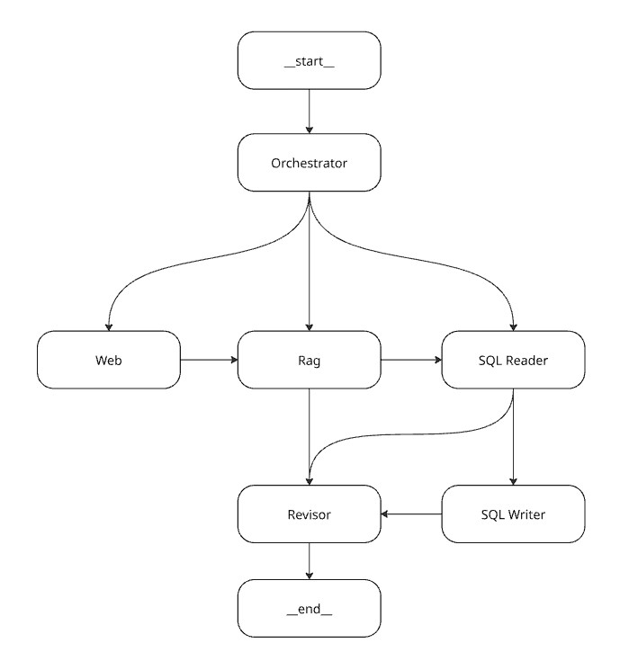

<div align="center">

# Enterprise LangGraph: Governança de TI com Multiagentes

Assistente corporativo multiagente, construído com **LangGraph**, que avalia pedidos de contratação de software. Ele cruza informações da web, das políticas internas da empresa (RAG) e do inventário de softwares (SQL) para entregar um parecer de conformidade e registrar a solicitação para revisão humana.


</div>

---

## Sumário

- [Sobre o projeto](#sobre-o-projeto)
- [Arquitetura dos agentes](#arquitetura-dos-agentes)
- [Tecnologias utilizadas](#tecnologias-utilizadas)
- [Estrutura de pastas](#estrutura-de-pastas)
- [Pré-requisitos](#pré-requisitos)
- [Instalação e execução](#instalação-e-execução)
- [Uso da API](#uso-da-api)
- [Exemplos de perguntas](#exemplos-de-perguntas)
- [Autor](#autor)

---

## Sobre o projeto

Em empresas grandes, cada pedido de uma nova ferramenta (por exemplo, *"Podemos usar o software X?"*) passa por várias etapas: pesquisar o fornecedor, conferir as políticas internas e a LGPD, ver se a empresa já tem algo parecido e, por fim, formalizar o pedido. Este projeto automatiza esse processo com uma **equipe de agentes de IA coordenada por um orquestrador**.

**O que ele faz:**

- **Pesquisa na web** sobre o fornecedor: política de privacidade, onde os dados ficam (*data residency*), termos de uso e concorrentes (via Tavily).
- **Consulta as políticas internas** da empresa a partir de um PDF indexado em um banco vetorial **FAISS** (RAG).
- **Consulta o inventário de softwares** já contratados para encontrar ferramentas com a mesma função.
- **Registra solicitações de contratação** no banco, com nível de risco e justificativa, para revisão humana (trilha de auditoria).
- **Gera um parecer final**, revisado e pronto para apoiar a decisão.
- **Mantém o contexto da conversa** por `thread_id`, guarda o histórico em SQLite e oferece uma interface de chat em React.

### Fluxos de atendimento

O orquestrador classifica cada pedido em um de dois fluxos:

| Fluxo | Quando é usado | Caminho no grafo |
|-------|----------------|------------------|
| **Complete** | Avaliação de uma nova contratação ou ferramenta externa | `Web → RAG → SQL Reader → SQL Writer → Revisor` |
| **Partial** | Consulta direta sobre normas internas ou ativos que a empresa já possui | `RAG → Revisor` ou `SQL Reader → Revisor` |

---

## Arquitetura dos agentes

<div align="center">
  
</div>

| Nó | Responsabilidade | Modelo | Ferramentas |
|----|------------------|--------|-------------|
| **Orchestrator** | Classifica o pedido, escolhe o fluxo e o próximo agente e monta a busca para a web (saída estruturada) | `gpt-5-mini` | — |
| **Web** | Pesquisa informações de compliance sobre o fornecedor | `gpt-4o-mini` | `search_web_tool` (Tavily) |
| **RAG** | Compara as informações com as políticas internas (PDF) | `gpt-4o-mini` | `retrieve_documents_tool` (FAISS) |
| **SQL Reader** | Procura ferramentas iguais ou parecidas no inventário | `gpt-4o-mini` | `software_inventory_reader_tool`, `list_all_software_inventory_tool` |
| **SQL Writer** | Registra a solicitação de contratação para revisão humana | `gpt-4o-mini` | `register_procurement_request` |
| **Revisor** | Junta o trabalho de todos os agentes em uma resposta final | `gpt-5-mini` | — |

Os prompts de sistema de cada agente ficam em arquivos YAML, em [`backend/services/graph/prompts/`](backend/services/graph/prompts/). A memória de curto prazo da conversa usa o `InMemorySaver` do LangGraph.

---

## Tecnologias utilizadas

### Backend
- **[Python 3.12](https://www.python.org/)**
- **[FastAPI](https://fastapi.tiangolo.com/)** + **[Uvicorn](https://www.uvicorn.org/)**: API REST
- **[LangGraph](https://langchain-ai.github.io/langgraph/)**: orquestração do grafo de agentes
- **[LangChain](https://python.langchain.com/)** (`langchain`, `langchain-openai`, `langchain-community`, `langchain-tavily`)
- **[OpenAI](https://platform.openai.com/)**: LLMs (`gpt-5-mini`, `gpt-4o-mini`) e embeddings (`text-embedding-3-small`)
- **[Tavily](https://tavily.com/)**: busca na web voltada para LLMs
- **[FAISS](https://github.com/facebookresearch/faiss)**: banco vetorial do RAG
- **[PyPDF](https://pypdf.readthedocs.io/)**: leitura do PDF de políticas internas
- **[SQLAlchemy](https://www.sqlalchemy.org/)** + **SQLite**: persistência (mensagens, inventário e solicitações)
- **[Rich](https://github.com/Textualize/rich)**: saída formatada no terminal

### Frontend
- **[React 19](https://react.dev/)** + **[Vite](https://vite.dev/)** (rolldown-vite)
- **[Axios](https://axios-http.com/)**: comunicação com a API
- **[react-markdown](https://github.com/remarkjs/react-markdown)** + `remark-gfm`: exibição das respostas em Markdown
- **[Lucide React](https://lucide.dev/)**: ícones

### Infraestrutura
- **[Docker](https://www.docker.com/)** + **Docker Compose**

---

## Estrutura de pastas

```
EnterpriseLanggraph/
├── backend/
│   ├── assets/
│   │   └── graph.jpg                 # Diagrama do grafo de agentes
│   ├── config/
│   │   ├── database.py               # Engine e sessão do SQLAlchemy (SQLite)
│   │   ├── db.sqlite3                # Banco de dados SQLite
│   │   └── faiss_index/              # Índice vetorial FAISS persistido
│   ├── docs/
│   │   └── politicas_internas.pdf    # Base de conhecimento usada pelo RAG
│   ├── models/                       # Modelos ORM (Message, SoftwareInventory, ProcurementRequest)
│   ├── routes/
│   │   └── chat.py                   # Endpoint POST /api/chat/
│   ├── scripts/
│   │   └── populate_database.py      # Seed do inventário de softwares
│   ├── serializers/                  # Schemas Pydantic de request/response
│   ├── services/
│   │   └── graph/
│   │       ├── agents/               # Criação dos agentes (LLM + prompt + tools)
│   │       ├── nodes/                # Nós do grafo que chamam os agentes
│   │       ├── prompts/              # Prompts de sistema em YAML
│   │       ├── schemas/              # Saída estruturada do orquestrador
│   │       ├── tools/                # Tools: web (Tavily), RAG (FAISS) e SQL
│   │       ├── utils/                # Carregamento de prompts e VectorStore (singleton)
│   │       ├── graph.py              # Montagem e compilação do StateGraph
│   │       └── state.py              # Estado compartilhado do grafo
│   ├── Dockerfile
│   ├── index.py                      # Ponto de entrada da aplicação FastAPI
│   ├── requirements.txt
│   └── test.py                       # Chat interativo pelo terminal
├── frontend/
│   ├── public/
│   ├── src/
│   │   ├── components/
│   │   │   ├── Chat.jsx              # Interface do chat
│   │   │   └── Chat.css
│   │   ├── config/
│   │   │   └── chatbotApi.js         # Cliente Axios para o backend
│   │   ├── App.jsx
│   │   └── main.jsx
│   ├── Dockerfile
│   ├── package.json
│   └── vite.config.js
├── .env.example                      # Modelo das variáveis de ambiente
├── docker-compose.yaml
└── README.md
```

---

## Pré-requisitos

- [Docker](https://docs.docker.com/get-docker/) e [Docker Compose](https://docs.docker.com/compose/) (recomendado)
- Uma chave de API da **OpenAI** ([obter aqui](https://platform.openai.com/api-keys))
- Uma chave de API da **Tavily** ([obter aqui](https://app.tavily.com/))

Para rodar sem Docker, você também vai precisar de **Python 3.12+** e **Node.js 20+**.

---

## Instalação e execução

### 1. Clone o repositório

```bash
git clone https://github.com/Ryans007/EnterpriseLangGraphUC.git
cd EnterpriseLangGraphUC
```

### 2. Configure as variáveis de ambiente

Copie o arquivo de exemplo e preencha suas chaves:

```bash
cp .env.example .env
```

O arquivo `.env` na **raiz do projeto** deve ficar assim:

```env
# Porta exposta pelo backend no host
BACKEND_PORT=8000

# Chaves de API
OPENAI_API_KEY=sk-...
TAVILY_API_KEY=tvly-...
```

| Variável | Descrição |
|----------|-----------|
| `BACKEND_PORT` | Porta do host mapeada para a API (o frontend também a usa para montar a URL do backend) |
| `OPENAI_API_KEY` | Chave da OpenAI, usada pelos LLMs e pelos embeddings |
| `TAVILY_API_KEY` | Chave da Tavily, usada pelo agente de busca na web |

### 3. Suba os containers

```bash
docker compose up --build
```

| Serviço | URL |
|---------|-----|
| Frontend (chat) | http://localhost:5173 |
| API (backend) | http://localhost:8000/api |
| Documentação Swagger | http://localhost:8000/docs |

> As tabelas do banco são criadas automaticamente quando a API inicia.

### 4. (Opcional) Popule o inventário de softwares

O script abaixo **apaga** os registros atuais do inventário e insere softwares de exemplo (Claude, IBM, Gaio, Adobe Firefly, ChatGPT Plus):

```bash
docker compose exec backend python -m scripts.populate_database
```

### 5. (Opcional) Índice vetorial do RAG

O índice FAISS já vem versionado em `backend/config/faiss_index/`. Se você trocar o arquivo `backend/docs/politicas_internas.pdf`, apague a pasta `faiss_index/`. O índice é gerado de novo na primeira consulta ao agente RAG.

---

### Execução local (sem Docker)

<details>
<summary>Clique para expandir</summary>

> **Atenção:** o caminho do SQLite em `backend/config/database.py` é absoluto (`sqlite:////backend/config/db.sqlite3`) e foi pensado para o container. Para rodar localmente, troque-o por um caminho relativo, por exemplo `sqlite:///config/db.sqlite3`.

**Backend**

```bash
cd backend
python -m venv .venv
source .venv/bin/activate        # Windows: .venv\Scripts\activate
pip install -r requirements.txt

# Coloque OPENAI_API_KEY e TAVILY_API_KEY em um arquivo backend/.env
uvicorn index:app --reload --port 8000
```

Para conversar com o grafo direto pelo terminal, sem a API:

```bash
python test.py
```

**Frontend**

```bash
cd frontend
npm install
VITE_BACKEND_PORT=8000 npm run dev   # Windows (PowerShell): $env:VITE_BACKEND_PORT=8000; npm run dev
```

</details>

---

## Uso da API

### `POST /api/chat/`

Envia uma mensagem ao grafo de agentes. Se não houver `thread_id`, uma nova conversa é criada.

**Request**

```json
{
  "user_message": "A equipe de IA quer contratar a IBM. Essa contratação é viável?",
  "thread_id": null
}
```

**Response**

```json
{
  "thread_id": "3f1c2a9e-8b7d-4c1e-9a52-6d0e1f2b3c4d",
  "user_message": "A equipe de IA quer contratar a IBM. Essa contratação é viável?",
  "ai_message": "### Resumo da Investigação\n...",
  "create_at": "2026-11-03 10:15:42"
}
```

Para continuar a mesma conversa, envie o `thread_id` recebido nas próximas requisições.

**Exemplo com cURL**

```bash
curl -X POST http://localhost:8000/api/chat/ \
  -H "Content-Type: application/json" \
  -d '{"user_message": "Já temos alguma ferramenta de IA para vídeo?"}'
```

---

## Exemplos de perguntas

| Pergunta | Fluxo esperado |
|----------|----------------|
| *"A equipe de Marketing quer contratar o Runway. É viável?"* | Complete: Web → RAG → SQL Reader → SQL Writer → Revisor |
| *"Qual é a nossa política sobre armazenamento de dados fora do Brasil?"* | Partial: RAG → Revisor |
| *"Já temos alguma ferramenta parecida com o ChatGPT no inventário?"* | Partial: SQL Reader → Revisor |

---

## Autor

**Ryan Soares**: [GitHub @Ryans007](https://github.com/Ryans007)

---

<div align="center">
  Feito com LangGraph
</div>
